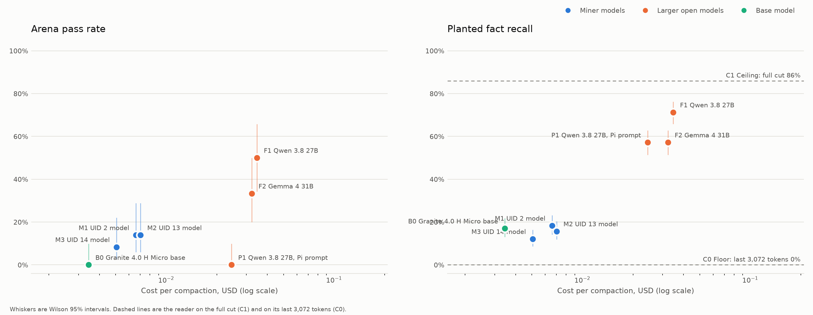
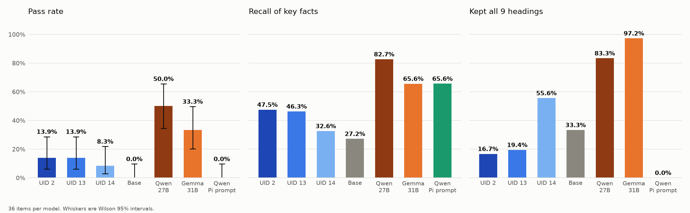
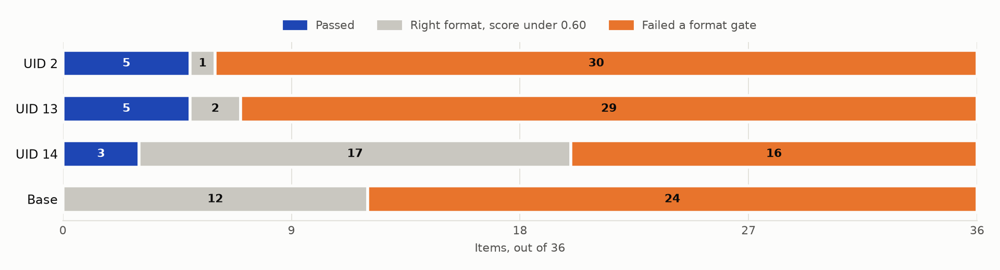
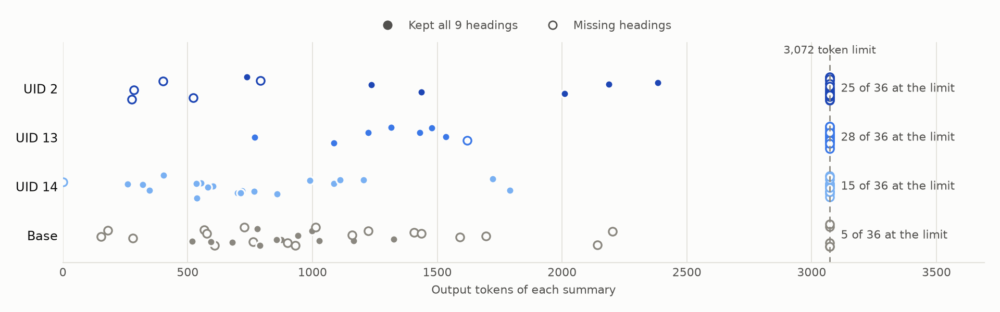

# Microtensor comparisons

Each Microtensor arena certifies small specialist models. This repository holds the experiments that test those models against much larger models and against the base model they were fine tuned from, on a dataset somebody else published. Everything needed to check or rerun an experiment is here: the items, the code, every model output, every grade, every reader reply, every judge verdict and the exact versions used.

The live summary of each run is on the Models page of the site, under **Compare with frontier**: https://www.microtensor.cloud/products/registry?tab=compare

## Runs

| Arena | Run | Dataset | Status | Report |
|---|---|---|---|---|
| `ctx_compress` (agent session compaction) | exp1, 2026-11-06 | Woolford compaction study replication package | Complete, except the hand check. No closed API model. | [ctx_compress/exp1](ctx_compress/exp1/README.md) |

## What the first run found

Seven models summarised 36 coding agent sessions. Three are the top fine tuned 3B models of the arena's first epoch and one is their base model, all on one RTX 4090. Two are the open 27B and 31B models the dataset's own study used, on a 48 GB card, and one of those ran a second time with Pi's own compaction prompt. A fixed reader then answered the study's questions from each summary alone.

A summary passes when our arena grader scores it at least 0.60 and it keeps every format rule.

| Model | Arena pass rate | 95% lower bound | Planted facts recalled | Commitments kept | Median time | Cost per compaction |
|---|---|---|---|---|---|---|
| Reader with the full session (ceiling) | | | 86% | 85% | | |
| Qwen 3.8 27B | 50.0% | 34.5% | 71% | 70% | 211 s | $0.035 |
| Gemma 4 31B | 33.3% | 20.2% | 57% | 67% | 195 s | $0.032 |
| Qwen 3.8 27B with Pi's prompt | other format | | 57% | 67% | 151 s | $0.024 |
| UID 2 (fine tuned 3B) | 13.9% | 6.1% | 18% | 56% | 28.5 s | $0.0066 |
| UID 13 (fine tuned 3B) | 13.9% | 6.1% | 16% | 63% | 28.6 s | $0.0070 |
| UID 14 (fine tuned 3B) | 8.3% | 2.9% | 12% | 74% | 13.6 s | $0.0051 |
| Granite 4.0 H Micro (base 3B) | 0% | 0% | 17% | 56% | 11.6 s | $0.0034 |
| Reader with the last 3,072 tokens (floor) | | | 0% | 41% | | |

In plain terms:

- The larger open models summarise these sessions much better. Qwen passes 18 of 36 and the best fine tuned model 5 of 36.
- The fine tuned models are about five times cheaper and seven times faster than Qwen, on a card half the size.
- The fine tuned models do not carry their arena results over to this dataset. UID 2 passed 25 of 25 hidden arena items and passes 5 of 36 here. On planted facts it is level with its own base model.
- The failure is mostly format. On these sessions the two strongest fine tuned models often repeat one phrase until they reach the 3,072 token limit and never write the later headings. 30 and 29 of their 36 summaries fail for that reason alone. When UID 2 does finish, 5 of its 6 complete summaries pass.
- Commitments do not separate the contestants. One fine tuned model kept the most (74%), but there are only 27 probes and the judges agreed only moderately.
- The arena's instruction carried more facts than Pi's own prompt on the same model: 71% against 57%.

Where each model's 36 items ended up:

The length of every summary shows the cause. Each dot is one summary; hollow dots are missing headings. The pile at the right edge is summaries that ran into the output limit:

## How an experiment works

1. **Dataset.** Take published sessions and their probes. Cut each session once, at the point the source study compacted it.
2. **Items.** Convert each cut to the arena's session format, render it the way the arena does, and build the arena's own labels from it.
3. **Summarise.** Every contestant gets the same instruction and the same rendered session, at temperature 0, with the same output limit.
4. **Grade.** The arena's grader scores every summary: format, budget, key fact recall, invented identifiers and continuation probes.
5. **Probe.** A fixed reader model answers the source study's own questions from each summary alone. Rules score the planted facts and a blind judge scores the commitments.
6. **Report.** Rates with Wilson intervals, paired McNemar tests, time and cost.

## Layout

| Path | What it holds |
|---|---|
| `ctx_compress/exp1/README.md` | The run report: dataset, contestants, settings, results, limits |
| `ctx_compress/exp1/data/` | The 36 items in the arena format, with the attached probes |
| `ctx_compress/exp1/results/` | Every summary, every grade, the tables, the charts, and the document the site reads |
| `comparisons/` | The code: build items, run models, grade, build reader and judge jobs, analyse, draw charts |
| `tools/` | Two small scripts that fetch and generate the source sessions |
| `docs/reproduce.md` | Step by step instructions to rerun everything |
| `docs/how-we-ran-it.md` | The machines, images, commands and costs of our own run |
| `docs/metrics.md` | Every metric and how it is computed |
| `NOTICE.md` | Third party material and its licences |

## Rerun it

Start with [docs/reproduce.md](docs/reproduce.md). Rebuilding the items and regrading our saved summaries needs only a CPU and Docker. Rerunning the local models needs one GPU with 24 GB of memory and access to the archived models, which are public but gated on Hugging Face.

## Licence

The code and results are under the terms in [LICENSE](LICENSE). The dataset comes from MIT licensed sources that keep their own licence; see [NOTICE.md](NOTICE.md).
