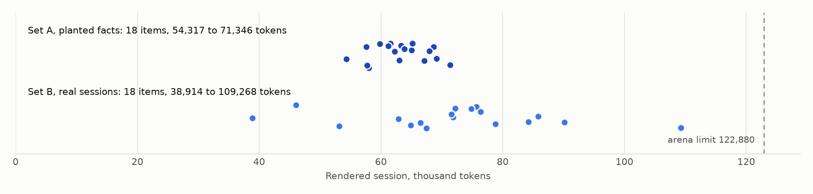
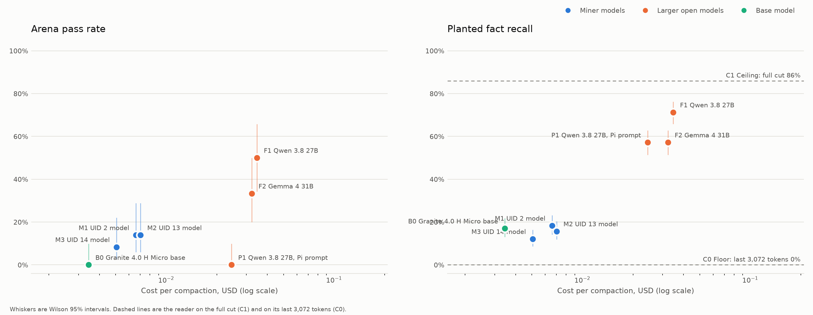
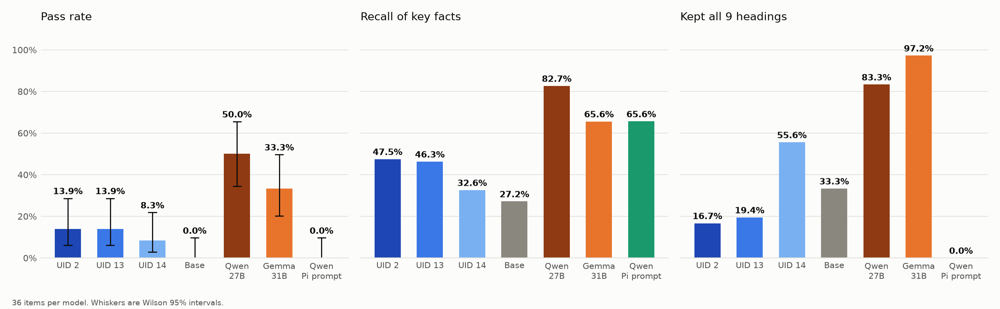
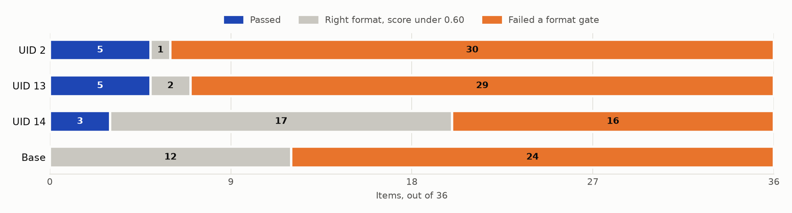
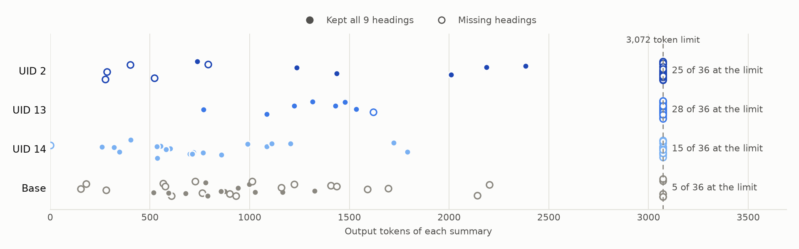

# ctx_compress exp1: compaction models against larger open models

Run date: 2026-11-06. Arena: `ctx_compress` on Bittensor testnet, epoch 0.

**Status: complete, except the hand check.** All nine contestants are summarised, graded, read and judged. No closed API model is in this run.

## Question

On a dataset we did not make, how do the top three models of the first `ctx_compress` epoch compare with much larger open models and with the base model they were fine tuned from, on pass rate, recall, hallucination, planted fact recall, commitments, cost and time?

## Dataset

Source: Woolford's replication package, https://github.com/felixwoolford/compaction-study-replication at commit `8c7c35f5d3222909c1ac8ef4bc44f90ba6a61512`, MIT licence.

| Set | Contents | Cut point | Items |
|---|---|---|---|
| A, planted facts | 18 synthetic debugging sessions made by the package's own generator (scenario `s1.json`, seed 5101). Each has 17 planted facts and 3 lures: 306 facts and 54 lures. | The study's first compaction point: the plant phase and round 1. | 18 |
| B, commitments | 18 real public Pi coding agent sessions from MIT licensed sources, verified by SHA-256. 29 commitment probes, of which the study scores 27. | The end of the session. The probe message comes after it. | 18 |

What happened when the cuts became arena items:

- **Nothing was dropped.** The rendered sessions are 38,914 to 109,268 tokens (median 66,490). The limit is 122,880.
- **Rendering is the arena's.** Each session is converted with the `pi` parser in the public arenas package and rendered inside `<session>` tags exactly as in the arena. That rendering keeps the head and tail of long tool output and does not carry the agent's thinking blocks.
- **33 planted facts are out of reach.** They were planted only in thinking blocks, so no contestant can see them. The most any contestant can recall is 273 of 306. All 99 tool output facts, all 99 user facts, all 42 assistant text facts and all 33 superseded facts are in the rendered text.
- **Every commitment survives.** The key strings of all 29 commitment probes appear in the rendered sessions.
- **Arena labels.** Key facts and continuation probes come from the arena's own builder. 8 facts and 1 probe that pointed at text the rendering trims were removed, so that every label can be answered from the session. There is no "next step" probe, because both cut points are followed by a new user message that nobody could predict.
- **Check.** `mta check` reports 36 items and 0 problems.

Files: `data/items.jsonl` (one row per item; the study's probes are under `label.attached`), `data/report.json` (the counts above), SHA-256 of `items.jsonl`: `c61e850fe00c50237a7be1e21e43f1c1acfa545e66ac66f693a56e41036a877a`.

## Contestants

| ID | Contestant | Runs on | Status |
|---|---|---|---|
| M1 | UID 2 model, weights `e7528c49…` | RTX 4090 | Done |
| M2 | UID 13 model, weights `b0bd36e4…` | RTX 4090 | Done |
| M3 | UID 14 model, weights `84b5d274…` | RTX 4090 | Done |
| B0 | Granite 4.0 H Micro base, revision `d5f01a3e…` | RTX 4090 | Done |
| F1 | Qwen 3.8 27B, `unsloth/Qwen3.8-27B-GGUF`, file `UD-Q6_K_XL` | Rented 48 GB card | Done |
| F2 | Gemma 4 31B, `unsloth/gemma-4-31B-it-GGUF`, file `UD-Q5_K_XL` | Rented 48 GB card | Done |
| P1 | Qwen 3.8 27B with Pi's own compaction prompt (the study's baseline method) | Rented 48 GB card | Done |
| C1 | Ceiling: the reader sees the full cut | Reader only | Done |
| C0 | Floor: the reader sees the last 3,072 tokens of the cut | Reader only | Done |

M1, M2 and M3 are archived at `microtensor-io/ctx_compress-e7528c49`, `microtensor-io/ctx_compress-b0bd36e4` and `microtensor-io/ctx_compress-84b5d274` on Hugging Face. The repos are public and gated: request access once.

F1 and F2 are the two open weight models the study itself ran, in the same quantised files. They are about nine and ten times the size of the arena's 3B base model. The study's two closed models are not in this run.

## Settings

| Setting | Value |
|---|---|
| Prompt | The arena's compaction instruction as the system message and the rendered session as the user message. P1 uses Pi 1.1.0's prompt instead (`results/work/pi_prompt.json`). |
| Decoding | Temperature 0, at most 3,072 output tokens. Local models stop at `<|end_of_text|>` with seed 0. |
| Engine for M1, M2, M3, B0 | `vllm/vllm-openai@sha256:6ee133356d49ed24cee03dd0cda3d3980279a11c107ce3e752c89e76540f41c9`, context 125,952 tokens, one sequence at a time, bfloat16, prefix caching off |
| Card for M1, M2, M3, B0 | One NVIDIA GeForce RTX 4090, 24 GB, 0.89 USD an hour |
| Server for F1, F2, P1, reader and judge | `ghcr.io/ggml-org/llama.cpp@sha256:821d0ae4e5d4e82a2ad8d08973b5f9cd5d0b84524b1d2439ed1f3e41ebc6b4c7` (build `b12124`), context 131,072 tokens (139,264 for the one session that needed it on Gemma), one request at a time for summaries, thinking off, seed 576 |
| Card for F1, F2, P1 | One NVIDIA A40, 48 GB, 0.59 USD an hour (`results/work/open_pod_info.json`) |
| Pass mark | Item score of at least 0.60 |
| Grader | `microtensor_subnet/validator/compress.py` from the public subnet repo, commit `09b3ed7c9f98825c6a35cfd5183bad961bc06d6d` |
| Probe model | `Qwen/Qwen2.5-1.5B-Instruct-GGUF`, file `qwen2.5-1.5b-instruct-q8_0.gguf`, revision `91cad51170dc346986eccefdc2dd33a9da36ead9`, at most 64 output tokens |
| Probe server | `ghcr.io/ggml-org/llama.cpp@sha256:43b3988c22c00faae3d04a8f6e3eba41403dff7c5f5952490599f1bcbdc6f3c2`, CPU, 4 threads |
| Tokenizer | `ibm-granite/granite-4.0-h-micro@d5f01a3ea75f088947be3aae039f4ad52837dfde` |
| Reader | Qwen 3.8 27B, thinking off, temperature 0, one probe per call. It sees only the contestant's summary, or the full cut for C1, or the last 3,072 tokens for C0. |
| Judge | Gemma 4 31B, one vote per reply, blind to the contestant. Qwen 3.8 27B rescores a random 25%. |
| Random seed for sampling | 20261106 (judge order, second judge sample, hand check sample) |

## Results

36 items per contestant. Full table: `results/summary.csv`. One row per contestant and item, with the summary text and every metric: `results/raw.jsonl`.

### The arena's grader

| | M1 (UID 2) | M2 (UID 13) | M3 (UID 14) | B0 (base) | F1 (Qwen 27B) | F2 (Gemma 31B) | P1 (Qwen, Pi prompt) |
|---|---|---|---|---|---|---|---|
| Passed | 5 | 5 | 3 | 0 | 18 | 12 | 0 |
| Pass rate | 13.9% | 13.9% | 8.3% | 0% | 50.0% | 33.3% | 0% |
| Wilson 95% interval | 6.1% to 28.7% | 6.1% to 28.7% | 2.9% to 21.8% | 0% to 9.6% | 34.5% to 65.5% | 20.2% to 49.7% | 0% to 9.6% |
| Kept all 9 headings | 6 | 7 | 20 | 12 | 30 | 35 | 0 |
| Within budget | 31 | 30 | 34 | 33 | 32 | 36 | 36 |
| Recall of key facts | 47.5% | 46.3% | 32.6% | 27.2% | 82.7% | 65.6% | 65.6% |
| Hallucination | 2.9% | 1.8% | 3.0% | 7.3% | 3.6% | 3.3% | 4.6% |
| Continuation (scorable summaries only) | 0.73 on 6 | 0.66 on 7 | 0.54 on 20 | 0.38 on 12 | 0.50 on 28 | 0.49 on 35 | none scorable |
| Median time | 28.5 s | 28.6 s | 13.6 s | 11.6 s | 211 s | 195 s | 151 s |
| p95 time | 30.5 s | 30.7 s | 30.1 s | 28.4 s | 253 s | 261 s | 197 s |
| Median time to first token | 3.4 s | 3.4 s | 3.4 s | 3.5 s | 75 s | 111 s | 74 s |
| GPU cost per compaction | $0.0059 | $0.0064 | $0.0044 | $0.0034 | $0.0348 | $0.0323 | $0.0244 |
| Cost per compaction with the list price ($0.01 per 1M input tokens, output free) | $0.0066 | $0.0070 | $0.0051 | not sold | not sold | not sold | not sold |

P1 writes Pi's own summary format, so it cannot pass the arena's format gate. Its recall and hallucination rows still count; its pass rate does not say anything about quality.

Where the items went, out of 36:

| | Passed | Right format, score under 0.60 | Failed a format gate | Reached the 3,072 token limit |
|---|---|---|---|---|
| M1 (UID 2) | 5 | 1 | 30 | 25 |
| M2 (UID 13) | 5 | 2 | 29 | 28 |
| M3 (UID 14) | 3 | 17 | 16 | 15 |
| B0 (base) | 0 | 12 | 24 | 5 |
| F1 (Qwen 27B) | 18 | 10 | 8 | 6 |
| F2 (Gemma 31B) | 12 | 23 | 1 | 1 |
| P1 (Qwen, Pi prompt) | 0 | 0 | 36 | 0 |

How long each summary ran. Each dot is one summary and hollow dots are missing headings:

### The study's probes

The reader answers each question from the contestant's summary alone. Planted facts are scored by the study's rule. Commitment replies are scored by the judge.

| Context given to the reader | Planted facts recalled, of 306 | Wilson 95% interval | Confident wrong answers, of 360 questions | Commitments kept, of 27 | Wilson 95% interval |
|---|---|---|---|---|---|
| C1, the full cut (ceiling) | 263 (86.0%) | 81.6% to 89.4% | 3.3% | 23 (85.2%) | 67.5% to 94.1% |
| F1, Qwen 27B summary | 218 (71.2%) | 65.9% to 76.0% | 2.2% | 19 (70.4%) | 51.5% to 84.1% |
| F2, Gemma 31B summary | 175 (57.2%) | 51.6% to 62.6% | 3.9% | 18 (66.7%) | 47.8% to 81.4% |
| P1, Qwen summary with Pi's prompt | 175 (57.2%) | 51.6% to 62.6% | 8.1% | 18 (66.7%) | 47.8% to 81.4% |
| M1, UID 2 summary | 56 (18.3%) | 14.4% to 23.0% | 3.3% | 15 (55.6%) | 37.3% to 72.4% |
| B0, base model summary | 52 (17.0%) | 13.2% to 21.6% | 5.8% | 15 (55.6%) | 37.3% to 72.4% |
| M2, UID 13 summary | 48 (15.7%) | 12.0% to 20.2% | 3.1% | 17 (63.0%) | 44.2% to 78.5% |
| M3, UID 14 summary | 37 (12.1%) | 8.9% to 16.2% | 3.3% | 20 (74.1%) | 55.3% to 86.8% |
| C0, the last 3,072 tokens (floor) | 0 (0%) | 0% to 1.2% | 1.1% | 11 (40.7%) | 24.5% to 59.3% |

No contestant took a lure.

Paired exact McNemar tests, two sided (`results/tests.csv`):

| Pair | Arena pass, 36 pairs | Planted facts, 306 pairs | Commitments, 27 pairs |
|---|---|---|---|
| M1 against F1 (Qwen 27B) | p = 0.0002 | p < 0.001 | p = 0.34 |
| M1 against F2 (Gemma 31B) | p = 0.09 | p < 0.001 | p = 0.55 |
| M1 against B0 (its base) | p = 0.06 | p = 0.69 | p = 1.0 |
| F1 against P1 (same model, arena prompt against Pi prompt) | not comparable | p < 0.001 | p = 1.0 |

### Reading it

- **The larger open models summarise these sessions much better.** Qwen passes 18 of 36 and Gemma 12, against 5 for the best fine tuned model. Qwen's lead is clear (p = 0.0002). Gemma's is not at this sample size (p = 0.09).
- **On planted facts the fine tuned models are level with their base.** M1's summaries let the reader recall 18.3% of the facts and the base model's 17.0% (p = 0.69). Qwen's summaries carry 71.2%.
- **Format is still the main failure for the two best fine tuned models.** M1 reached the 3,072 token limit on 25 items and M2 on 28, usually by repeating one phrase. A summary cut off that way is missing its later headings and most of the session's facts.
- **When they finish, they are good.** M1's complete summaries average an item score of 0.72 and 5 of 6 pass.
- **The small models are much cheaper and faster.** M1 costs about a fifth of Qwen per compaction (5.3 times cheaper) and takes 28.5 s against 211 s (7.4 times faster), on a card half the size. M3 is 15 times faster.
- **Commitments do not separate the contestants.** M3 kept 74% and Qwen 70%, every interval overlaps, and no pair differs significantly. The two judges agreed only moderately (kappa 0.51 on 61 replies), so read this column as rough.
- **The arena's instruction carried more facts than Pi's.** On the same Qwen model, the arena's nine heading summary let the reader recall 71.2% of planted facts against 57.2% with Pi's own prompt (p < 0.001), with fewer confident wrong answers (2.2% against 8.1%).
- **Fine tuning moved the arena's own measures.** Against the base model the best fine tuned model recalls 75% more key facts on the arena grader and invents 75% fewer identifiers.
- **The ceiling is 86%, not 100%.** 33 facts sit only in thinking blocks, so 89% is the most anyone could reach; the reader with the full session got 86%.

## Limits of this run

- **36 items is a small sample.** The Wilson intervals are wide. M1 and M2's true pass rate could sit anywhere from 6% to 29%, and Qwen's from 34% to 66%.
- **This is not the study's protocol, so these numbers cannot be set beside the study's tables.** The study compacts inside Pi at about 40,000 tokens, keeps the last 8,000 tokens verbatim and lets the agent think. Here every contestant writes one summary of the whole cut, and the reader sees only that summary, with thinking off.
- **The open models ran with thinking off.** With thinking on they would be slower and might score higher.
- **The reader and the judge are open models.** The study judged with Claude Sonnet and reports agreement between two judges of kappa 0.85 to 1.0. Ours is 0.51. The judge gave one vote per reply, because it is deterministic at temperature 0.
- **No closed API model is in this run.** The study's GPT models and the Claude models we first planned are not here.
- **Some Qwen timings are part fitted.** The streams of 21 of the 72 Qwen summaries (12 of F1, 9 of P1) dropped and resumed from the server's prompt cache. Their time is the measured generation time plus prompt time fitted on the other rows of the same model (`results/work/prompt_time_fit.json`, R² 0.93). Every Gemma time is measured. 19 rows were timed at the client and include a few seconds of network. The `timing` field of each row in `results/work/outputs/` says which.
- **Cost is rental price at one request at a time.** That holds for every contestant. A deployment that batches requests would pay less per compaction on either card.
- **Token counts for F1, F2 and P1 are in each model's own tokenizer.** The budget check uses the arena's tokenizer for everyone.
- **Continuation is measured only on scorable summaries.** A summary that fails format or budget scores zero whatever its continuation would be, so the probe model was not run on those.
- **The list price changed after the first models ran.** A compaction listed at a flat $0.005 then. On 2026-11-06 the price became $0.01 per million input tokens with output tokens free, which is about $0.0007 for a typical session here. The cost figures use the new price. Measured GPU cost is unchanged and is higher than the list price.
- **Both pod prices were secure cloud prices.** No cheaper community card was free at the time.
- **Set A was generated with Python 3.11.** The replication package asks for 3.14. The generator only uses the standard library's seeded random module, and the built plans passed the package's own consistency checks.
- **The hand check is not done.** `results/hand_check.md` lists ten summaries drawn at random for a person to read against their sessions.
- **Epoch 0 arena scores are not comparable to these.** The arena used 25 hidden items of its own kind per pool. This run uses 36 sessions of a different shape.

## Files

| File | Contents |
|---|---|
| `data/items.jsonl` | The 36 items |
| `data/report.json` | Token range, drops, planted fact and commitment counts |
| `results/work/outputs/<ID>.jsonl` | Every raw summary with tokens, time to first token, total time and how it was timed |
| `results/work/graded/<ID>.jsonl` | Every grade with the probe model's answers |
| `results/work/summaries.jobs.results.jsonl` | Every call to the open models: text, tokens, attempts, client and server timings |
| `results/work/retime.jobs.results.jsonl` | The timing reruns that finished |
| `results/work/reader.jobs.results.jsonl` | Every reader reply, 3,483 rows |
| `results/work/judge.jobs.results.jsonl` | Every verdict with its reason, 243 first judge rows and 61 second judge rows |
| `results/work/judge.key.json` | Which blind reply belongs to which contestant and probe |
| `results/work/floor_contexts.json` | The text the reader saw for C0 |
| `results/work/pod_info.json`, `open_pod_info.json` | Card, image and price of each GPU run |
| `results/work/prompt_time_fit.json` | The prompt time fit used for the 21 resumed Qwen rows |
| `results/work/grader_info.json` | Probe model, image, command and grading rules |
| `results/work/pi_prompt.json` | Pi's compaction prompt, taken from its published package |
| `results/raw.jsonl` | One row per contestant and item with the summary, every metric and every probe answer |
| `results/summary.csv` | One row per contestant |
| `results/tests.csv` | McNemar tests |
| `results/comparison.json` | The document the Models page reads |
| `results/hand_check.md` | The ten summaries for the hand check |
| `results/chart.png` | Pass rate and planted fact recall against cost |
| `results/charts/` | `dataset.png`, `quality.png`, `failures.png`, `output_length.png`, drawn by `python -m comparisons.charts` |

The job input files (`*.jobs.jsonl`) are not stored because they repeat the sessions. `python -m comparisons.jobs` rebuilds them from the items.

## Rerun

See [docs/reproduce.md](../../docs/reproduce.md).
